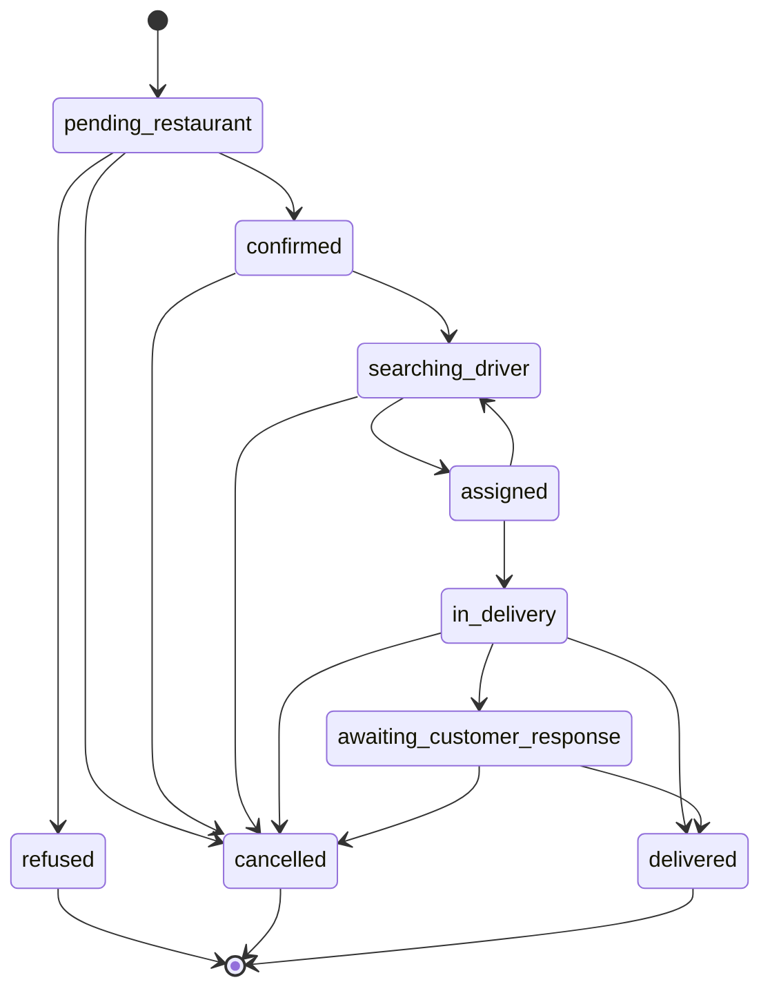

# Machine à états des commandes

## Diagramme Mermaid

## Table des transitions autorisées

| Statut source | Statut cible | Acteur | Règle métier |
| --- | --- | --- | --- |
| pending_restaurant | confirmed | restaurant_admin | validation du restaurant |
| pending_restaurant | refused | restaurant_admin | refus avec motif |
| pending_restaurant | cancelled | customer | annulation avant confirmation |
| confirmed | searching_driver | system | demande d’attribution du livreur |
| confirmed | cancelled | admin | annulation par l’administration |
| searching_driver | assigned | system | affectation atomique d’un livreur |
| searching_driver | cancelled | customer_or_admin | annulation si impossible à livrer |
| assigned | in_delivery | driver | livraison commencée |
| assigned | searching_driver | driver_or_system | signalement de problème / réattribution |
| in_delivery | delivered | driver | code de livraison valide |
| in_delivery | awaiting_customer_response | driver | attente de validation client |
| in_delivery | cancelled | admin | intervention de sécurité |
| awaiting_customer_response | delivered | customer | validation finale du client |
| awaiting_customer_response | cancelled | customer_or_admin | annulation ou refus final |

## Règles de stockage

- Chaque transition doit être enregistrée dans order_status_history.
- Chaque enregistrement conserve : ancien_statut, nouveau_statut, acteur, raison, horodatage.
- La fonction transition_order(order_id, new_status, actor, reason) est la voie d’écriture unique pour l’état de commande.
- Le statut de paiement est indépendant du statut de livraison.
